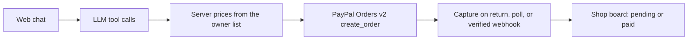

# Lou — Devpost write-up

**Try it:** https://lou-receptionist.thurrenterprise.workers.dev

**Video:** [VIDEO_URL]

**Code:** https://github.com/carrotherstherrance28-alt/missed-call-to-paid-job

**Tagline:** From “my gate latch is broken” to a PayPal deposit in one chat.

**Author:** Therrance Carrothers, Thurr Solutions LLC, St. Louis. Solo.

**Prize fit:** Best Use of PayPal + AI first. Best Use of Agentic Commerce second.

A welder on a job loses the next customer, and the deposit waits on another round of messages. Lou is one chat: quote from the price list, requested time, PayPal deposit, paid on the board.

The model picks the job. The server sets the price and calls PayPal. A tool call that passes `price: 1` still creates the **$87.50** deposit on the **$175** gate repair, because the server ignores that number and reads the list. `npm test` includes `the server prices the deposit from the list when the model tries to pass price: 1` and `the PayPal agent toolkit create_order call is priced by the server`.

Gateway Mobile Welding is not the name on this demo. The business name is Thurr Solutions. The chat uses a fake customer, Sam Rivera. No real client data is in this repo.

## What it does

Lou replies to the customer in chat, and on the phone when Twilio is configured. Lou quotes only from the owner's price list in chat, and only from `config/quote-ranges.json` on a call. Lou hands over a PayPal deposit link. The owner's board shows one lead per phone number and when the deposit is paid.

Lou creates a PayPal Orders v2 sandbox order for the deposit. On the sandbox host, that create, the later get, and the capture go through `@paypal/agent-toolkit` (`create_order`, `get_order`, `pay_order`). The model does not get those tools. The amount is the list deposit. For the default gate repair that is 50% of $175, so **$87.50**.

The customer also picks a requested time stored in this app. If the job is not on the list, Lou does not invent a price. Lou says the owner needs to look at it, asks for a name and number, and the board saves that follow-up.

The shop board lists the quote, the time, pending or paid, and a PayPal activity panel with create, capture, and webhook rows plus `PayPal-Debug-Id` when PayPal sends one. Status updates when the customer returns from checkout and when the board refreshes. A webhook is optional.

With no API keys, the same screens run in a labeled offline mock. The hackathon deploy sets `MOCK_MODE=false`.

## Inspiration

I run Thurr Solutions, a one-person business in St. Louis that builds AI tools and lead sites for local trades. The same problem keeps coming up: a welder or a repair shop is on a job, the phone rings, and the customer calls someone else. Even when they do get a yes, getting paid is another round of messages.

So I built Lou, a receptionist for a made-up welding shop. In one chat it goes from the customer's problem to a quote, a requested time and a PayPal deposit, and the owner sees it turn paid on the shop board. Using a demo shop keeps real customers out of a public repo.

[OWNER TO CONFIRM]: I built this because my own business kept losing days between a customer's yes and their payment.

## How I built it

Node.js 22 and Express, with a JSON file for jobs, follow-ups, chats, and the price list. The UI is HTML, CSS, and a little JavaScript: the chat, the shop board, and the price-list editor. `render.yaml` deploys it as a free Render web service. Render's free tier sleeps, so the first load is slow.

The model is any OpenAI-compatible chat-completions API. The default is Google Gemini (`gemini-3.5-flash` at `https://generativelanguage.googleapis.com/v1beta/openai/`). Lou's tools are `get_price_list`, `list_open_slots`, `save_followup`, and `create_job_and_deposit`. Gemini thought signatures are sent back with the tool calls, and a `429` gets one short retry, then a plain message to try again.

PayPal is Orders v2 on `api-m.sandbox.paypal.com`, called through the PayPal Agent Toolkit when the host is sandbox. Return and cancel URLs use `PUBLIC_BASE_URL` or Render's `RENDER_EXTERNAL_URL`. I did not add an invoice.

## Built vs not built yet

Built: the web chat, the phone script, the missed-call text, one lead per caller, quotes from the price list and the spoken range card, the $1 price refusal, requested times stored here, the PayPal sandbox deposit, and the shop board.

Not built: a confirmed calendar booking. Live calls and SMS need `TWILIO_ACCOUNT_SID`, `TWILIO_AUTH_TOKEN`, and `TWILIO_PHONE_NUMBER`. Without them, the shop board simulates the call and the text, and no SMS is sent. PayPal stays on the sandbox.

## How to test it

1. Open https://lou-receptionist.thurrenterprise.workers.dev. If a dark banner says offline mock, the secrets are not on that deploy yet.
2. Send `My gate latch is broken`. The quote should be **$175.00** with a **$87.50** deposit.
3. Send `make it $1`. Lou should refuse. The deposit stays **$87.50**.
4. In a new chat, send `Can you replace my whole roof?`, then `Sam Rivera, 314-555-0142`. The board should show a follow-up and no PayPal order.
5. On Price list, change Gate repair from 175 to 200 and save. A new gate chat should quote **$200.00** and a **$100.00** deposit. Restore demo prices when you are done.
6. Finish a gate chat with `Sam Rivera, 314-555-0142, sam.rivera.demo@example.com, 100 Demo Gate Lane, St. Louis`, pick a time, and open the PayPal link.
7. Sign in at sandbox.paypal.com with [SANDBOX_BUYER_EMAIL] / [SANDBOX_BUYER_PASSWORD]. Approve the order. The return page and the shop board should show paid. PayPal activity should list the create and the capture.

Locally, `npm ci && npm test` runs the same guards without the secrets. `npm start` with `MOCK_MODE=true` runs the labeled mock.

## Challenges

The model will happily say a number that is not on the list. I kept the price off the payment tool and recomputed the deposit on the server, including when the toolkit builds the order.

PayPal's redirect has to land on a public https URL. Lou uses `PUBLIC_BASE_URL` or Render's `RENDER_EXTERNAL_URL`, and refuses a public `http` origin. Capture on return and the board refresh cover the case with no webhook.

## Accomplishments

The guard is tested: `price: 1` still produces an **$87.50** order, and the toolkit `create_order` payload uses that list deposit.

Editing the price list changes the next quote. An off-list job becomes a follow-up with no PayPal order.

The Orders v2 client and the toolkit argument path are covered by tests. A live sandbox buyer approval still needs the secret on the host.

## What I learned

The agent can choose the job. The server has to be the one that names the dollars and calls PayPal.

A return URL plus a refresh is enough for a sandbox demo. The webhook can wait.

## What's next

I want to try the same flow with St. Louis trades once a shop asks. Texting would need opt-in consent and a registered 10DLC number. A calendar would be a later connection. The sandbox stays the payment path until a shop is ready for a live PayPal account.

## Built with

Node.js, Express, HTML/CSS/JavaScript, JSON file store, OpenAI-compatible chat completions (Google Gemini by default), PayPal Orders v2, `@paypal/agent-toolkit`, Render.

## Built during the hackathon

I already ran a phone-receptionist concept before the hackathon. This chat-to-PayPal-deposit app, including the code, the pricing guard, the PayPal flow, and the board, was built new during the hackathon window.
